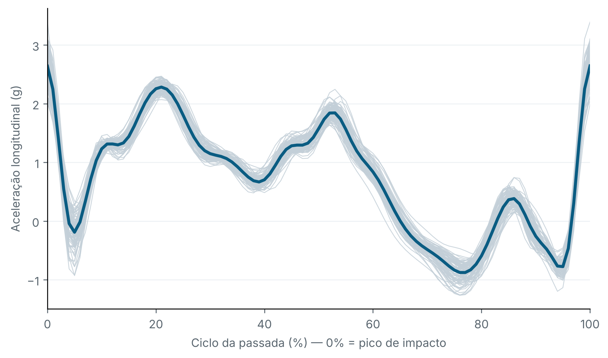
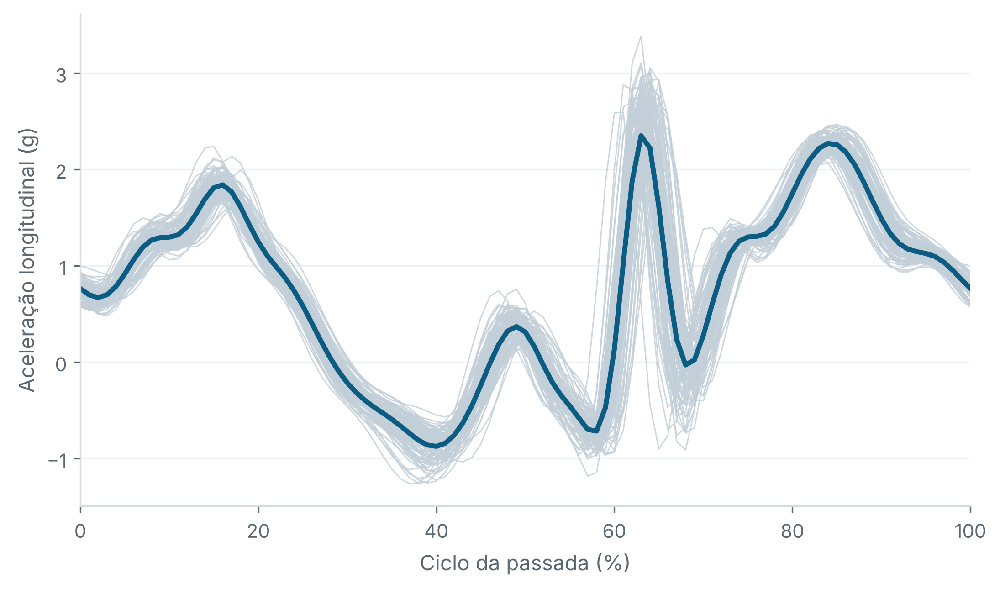

# Tibial acceleration variability in running

Analysis pipeline for a small experimental study on how running experience and treadmill speed affect the variability of tibial acceleration. It was developed as the final project of a Motor Control course in the Graduate Program in Physical Education at the State University of Londrina (UEL), Brazil.

**Research question.** Do experienced and inexperienced runners differ in stride-to-stride variability, and does that difference depend on running speed?

**Design.** 10 recreational runners (5 experienced, 5 inexperienced) ran on a treadmill at three speeds: preferred (PREF), −10% and +10% of preferred. Each participant wore a triaxial IMU (WitMotion WT901BLE, ~200 Hz) on each tibia.


*100 consecutive strides (grey) and their mean (blue): longitudinal tibial acceleration, left leg, preferred speed, participant P01. Here 0% is the longitudinal acceleration peak used by the exploratory segmentation heuristic.*

## What the pipeline does

1. Reads files named `participant_condition_speed.txt`, where `@` is the decimal separator (e.g. `P01_+10_8@8.txt`).
2. Splits the two sensors (right and left leg).
3. Detects one event per stride, from the peak of the anteroposterior acceleration (low-pass 6 Hz), and builds the stride-time series.
4. Runs a quality check. A leg is rejected if any stride interval falls outside 0.55–1.10 s. Missed peaks are never interpolated, because that would distort the temporal structure of the series.
5. On the 100 central strides it computes:
   - **stride-time CV (%)**
   - **waveform variability (%)**: the mean point-by-point SD across time-normalised cycles, divided by the peak-to-peak amplitude of the mean curve. The primary signal is longitudinal (axial) acceleration. The 3D resultant is a sensitivity analysis.
6. On the 128 central strides it computes an exploratory **α-DFA** of the stride-time series.
7. Averages the two legs and fits **linear mixed models** (group × condition, random intercept per participant), followed by Welch and paired t-tests with Holm correction.

`analise_complementar.py` adds three robustness checks:
- the same mixed model on stride-time CV;
- α-DFA recomputed with alternative scale ranges;
- a white-noise simulation to measure the bias of the DFA estimator itself.

`sensibilidade_marco_impacto.py` tests how much the results depend on the stride event used for segmentation (see Limitations).

## Example results (participant P01)

Only P01's data are public. The group-level models need the full dataset.

| Measure | −10% | PREF | +10% |
|---|---|---|---|
| Cadence (steps/min) | 154 | 157 | 154 |
| Stride-time CV (%) | 1.61 | 1.37 | 1.59 |
| Waveform variability, longitudinal (%) | 6.3 | 5.3 | 6.3 |
| α-DFA (exploratory) | 0.45 | 0.55 | 0.45 |

These are bilateral means, segmented on the original anteroposterior-peak event.

## Limitations

**1. Variability depends on the segmentation event.** The pipeline starts each cycle at the peak of anteroposterior acceleration. An exploratory alternative selects the maximum longitudinal acceleration within 45–80% of each AP-defined cycle. For P01, the interval between these two markers varies by approximately 7–12 ms (SD) across strides. Their correspondence to toe-off and initial contact has not been validated against a reference method. Re-segmenting P01's data using the longitudinal acceleration peak gives these results (bilateral means):

| Measure | Event | −10% | PREF | +10% |
|---|---|---|---|---|
| Waveform variability (%) | AP peak (original) | 6.3 | 5.3 | 6.3 |
| | Longitudinal peak (exploratory) | 3.2 | 3.3 | 3.2 |
| Stride-time CV (%) | AP peak (original) | 1.61 | 1.37 | 1.59 |
| | Longitudinal peak (exploratory) | 1.03 | 1.03 | 0.90 |

For P01, the longitudinal-peak segmentation yields lower variability, and the apparent minimum at preferred speed is no longer evident. This comparison shows sensitivity to the segmentation method; lower variability alone does not establish which marker is more accurate. Both markers require validation against a reference method before they can be interpreted as specific gait events. The detector in `sensibilidade_marco_impacto.py` is an unvalidated heuristic.


*100 central strides segmented on the original event. Here 0% is the anteroposterior acceleration peak, and the longitudinal acceleration peak appears at approximately 60–65% of the cycle.*

**2. α-DFA on 128 strides is biased with the default scales.** With scales 4–64 and quadratic detrending, white noise (true α = 0.50) returns α ≈ 0.62. With scales 8–32 it returns ≈ 0.55, and with linear detrending ≈ 0.51 (2,000 simulations; see `analise_complementar.py`). The α-DFA values should be treated as exploratory.

**3. Small sample.** With n = 10 (5 per group), the group comparisons are a pilot study and are not powered for inference.

**4. Filtering.** The 20 Hz low-pass used for the waveforms attenuates the impact peak by about 30% (≈ 3.9 g raw vs ≈ 2.7 g filtered). The waveforms describe the shape of the signal and should not be used as peak tibial acceleration values.

**5. Timing.** The BLE sensors timestamp samples in batches: 83% of consecutive timestamps are identical. Time is therefore taken from the sample count at a nominal 200 Hz, not from the timestamp column.

## How to run

```bash
pip install -r requirements.txt
cd src
python analise_acelerometria_hurst.py   # main pipeline, run first
python analise_complementar.py          # robustness checks
python figura_ciclos.py                 # stride-cycle figures
python sensibilidade_marco_impacto.py   # segmentation-event sensitivity
```

Outputs are written to `results/`. The CSVs use `;` as the separator and `,` as the decimal mark, so they open directly in Excel with Brazilian locale settings.

Code comments and variable names are in Portuguese.

## Repository structure

```
data/      P01 raw data (DeviceName + AccX/Y/Z, ~200 Hz, tab-separated)
src/       analysis scripts
figures/   figures used in this README
```

## Data and ethics

Participants are identified by codes. Only the author's own recordings (P01) are published. The other participants' data are not shared.

## Notes

The code was developed with AI assistance.

## Author

Vítor Cimonetti, PhD student, Applied Biomechanics Laboratory, State University of Londrina (UEL) · [LinkedIn](https://linkedin.com/in/vitor-cimonetti)

Licensed under the MIT License.
